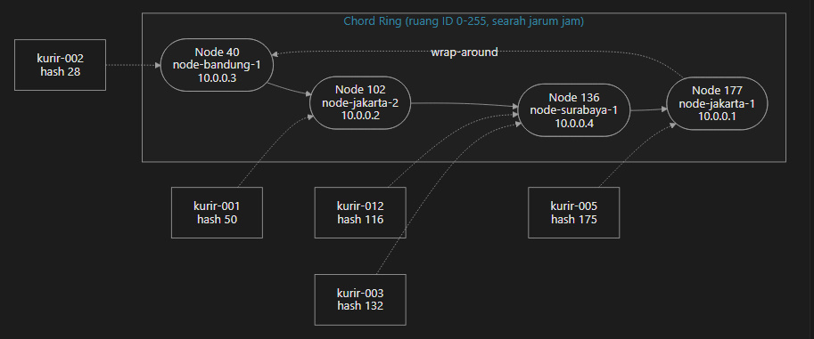
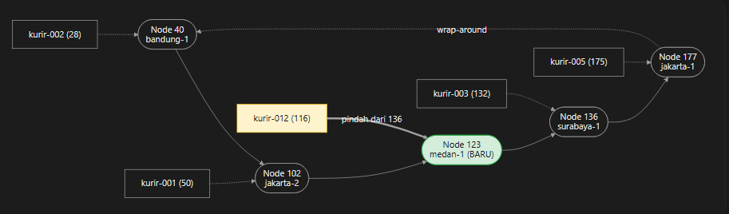
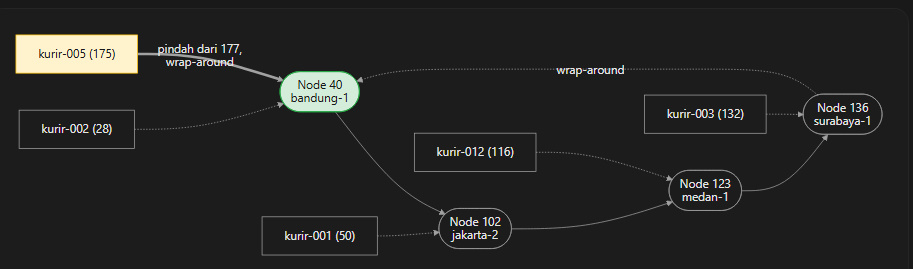

# Tugas 6 (Pekan 6) — Penamaan & Resolusi Lokasi

**Materi terkait:** Flat Naming, Structured Naming (DNS), Distributed Hash Table (DHT)/Chord.

## 1. Ring Awal (4 Node, 5 Kurir)



Empat node bergabung, dan hash SHA-1 mengurutkannya melingkar: **40 (Bandung-1), 102 (Jakarta-2), 136 (Surabaya-1), dan 177 (Jakarta-1)**.

Panah putus-putus dari node 177 kembali ke node 40 menunjukkan bahwa ring bersifat melingkar, bukan garis lurus. Panah dari kurir ke node menunjukkan node yang bertanggung jawab terhadap masing-masing kurir.

- **kurir-002 (hash 28)** masuk ke node 40 karena 40 adalah node pertama yang ≥ 28.
- **kurir-001 (hash 50)** masuk ke node 102 karena node 40 sudah terlewati dan 102 merupakan node pertama yang ≥ 50.
- **kurir-012 (hash 116)** dan **kurir-003 (hash 132)** keduanya masuk ke node 136. Artinya, satu node dapat menangani beberapa kurir.
- **kurir-005 (hash 175)** masuk ke node 177.

Diagram ini menjadi kondisi **sebelum** untuk dibandingkan dengan dua diagram berikutnya.

---

## 2. Setelah `node-medan-1` JOIN (Hash 123)



Node baru dengan hash **123** masuk di antara node 102 dan 136. Node 123 sekarang menjadi *successor* bagi key yang berada pada rentang **103 sampai 123**, yang sebelumnya dilayani oleh node 136.

Dari lima kurir, hanya **kurir-012 (hash 116)** yang berada pada rentang tersebut. Oleh karena itu, tanggung jawabnya berpindah dari node 136 ke node 123.

> **kurir-012: Node 136 → Node 123**

Empat kurir lainnya tetap berada pada node sebelumnya.

Hal ini merupakan inti dari **consistent hashing**, yaitu penambahan satu node hanya menyebabkan sebagian data berpindah, bukan seluruh mapping harus dihitung ulang seperti pada metode `hash mod jumlah_node`.

---

## 3. Setelah `node-jakarta-1` LEAVE (Hash 177)



Node 177 meninggalkan ring. Node tersebut sebelumnya hanya bertanggung jawab terhadap **kurir-005 (hash 175)**.

Sebelum node 177 keluar:

```text
kurir-005 (hash 175)
        ↓
Node 177
```

Setelah node 177 dihapus, tidak ada node dengan ID ≥ 175. Node terbesar yang tersisa adalah node 136.

Karena tidak terdapat *successor* setelah hash 175, Chord melakukan **wrap-around** ke node dengan hash terkecil, yaitu **node 40 (node-bandung-1)**.

Sehingga mapping berubah menjadi:

```text
kurir-005 (hash 175)
        ↓
Node 40
```

Kurir lain tidak terpengaruh karena penanggung jawabnya bukan node yang keluar.

---

# Tugas Analisis

## 1. Mengapa DHT/Chord Lebih Cocok?

Pada kasus FoodGo, **IP kurir sering berubah** karena kurir dapat berpindah jaringan, misalnya dari Wi-Fi ke jaringan seluler atau berpindah antar-BTS. Setiap perubahan IP harus dapat diperbarui dan ditemukan dengan cepat oleh pelanggan FoodGo.

### Flat Naming Sederhana

Pada flat naming sederhana, dapat digunakan tabel pusat seperti:

```text
ID Kurir    IP
kurir-001   192.168.1.10
kurir-002   192.168.1.11
kurir-003   192.168.1.12
```

Cara ini sederhana, tetapi jika tabel berada pada satu server pusat, server tersebut dapat menjadi **bottleneck** dan **single point of failure**. Jika server mengalami gangguan, proses pencarian ID Kurir ke IP dapat terganggu.

Selain itu, setiap perubahan IP kurir harus memperbarui tabel pusat.

### DNS Konvensional

DNS dapat digunakan untuk melakukan resolusi nama ke alamat IP, tetapi DNS menggunakan struktur hierarkis dan pada dasarnya dirancang untuk resolusi nama domain.

Pada kasus FoodGo, sistem membutuhkan pemetaan **ID Kurir yang tetap** ke **IP yang dinamis**, sekaligus pembagian tanggung jawab data ke beberapa node secara terdistribusi.

### DHT/Chord

DHT/Chord lebih sesuai karena ID Kurir dan ID node dipetakan menggunakan **consistent hashing** ke ruang identifier yang sama.

Prosesnya dapat digambarkan sebagai:

```text
ID Kurir
   ↓
Consistent Hashing
   ↓
Hash Key
   ↓
Successor pada Chord Ring
   ↓
IP Kurir
```

Dengan mekanisme tersebut, FoodGo tidak bergantung pada satu server pusat. Data dapat dibagi ke beberapa node berdasarkan posisi pada ring.

Ketika IP kurir berubah, ID Kurir tetap digunakan sebagai identitas untuk melakukan lookup terhadap IP terbaru. Ketika terjadi perubahan topologi, hanya mapping yang terdampak yang perlu berpindah.

Dengan demikian, Chord lebih cocok karena dapat menangani **IP kurir yang dinamis, distribusi data, perubahan topologi, serta mengurangi ketergantungan terhadap single point of failure**.

---

## 2. Ring Topology dan Mapping Kurir


Setelah `node-medan-1` dengan hash **123** bergabung, **kurir-012** berpindah dari node 136 ke node 123.

Mapping kurir setelah JOIN:

| ID Kurir | Hash | Node Penanggung Jawab | IP Kurir |
|---|---:|---:|---|
| `kurir-001` | 50 | Node 102 | `192.168.1.10` |
| `kurir-002` | 28 | Node 40 | `192.168.1.11` |
| `kurir-003` | 132 | Node 136 | `192.168.1.12` |
| `kurir-012` | 116 | **Node 123** | `192.168.1.13` |
| `kurir-005` | 175 | Node 177 | `192.168.1.14` |

Perpindahan tersebut ditunjukkan oleh output program:

```text
[MOVE] kurir-012 (hash=116) pindah tanggung jawab
dari node 136 ke node 123
```

---

## 3. Perubahan Mapping Ketika Node Keluar

Ketika `node-jakarta-1` dengan hash **177** keluar dari ring, tanggung jawab mapping yang sebelumnya berada pada node tersebut harus dialihkan ke *successor* berikutnya.

1. Sebelum `LEAVE`, **kurir-005** berada di node 177 karena 177 merupakan node pertama dengan ID ≥ 175.

2. Setelah node 177 dihapus, node terbesar yang tersisa adalah 136, yang lebih kecil dari 175. Karena tidak ada *successor* biasa, terjadi **wrap-around** ke node terkecil, yaitu node 40.

3. Node 40 kemudian mengambil alih tanggung jawab terhadap `kurir-005`.

Output program menunjukkan:

```text
[LEAVE] Node 'node-jakarta-1' (id=177) keluar dari ring
    [MOVE] kurir-005 (hash=175) pindah dari node 177 ke node 40
```

Lookup setelah node keluar juga tetap berhasil:

```text
[LOOKUP] kurir-005 (hash=175) -> node 40 -> 192.168.1.14
```

Hal ini menunjukkan bahwa **IP kurir tetap sama**, yaitu `192.168.1.14`. Yang berubah hanya node yang bertanggung jawab terhadap mapping tersebut.

Kurir lain tidak terpengaruh karena penanggung jawabnya bukan node yang keluar. Dengan demikian, kepergian satu node tidak menyebabkan seluruh mapping harus dihitung ulang.

